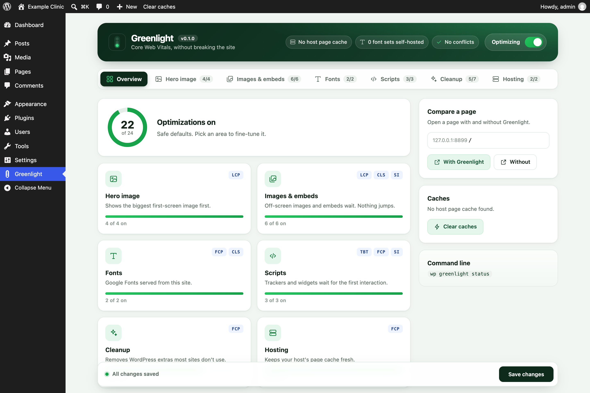
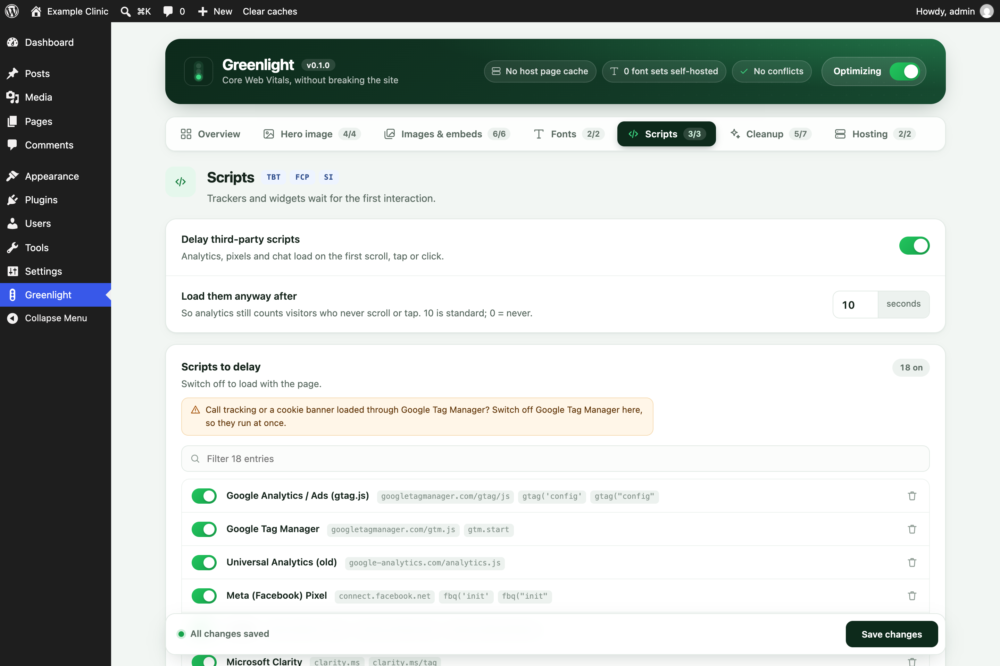

# Greenlight

A WordPress plugin for the front-end fixes that actually move Core Web Vitals (LCP, CLS, TBT, FCP,
Speed Index), built from what worked on real WP Engine sites. **No page cache**: WP Engine, Kinsta,
SiteGround, Flywheel and Pantheon already cache pages at the server (WP Rocket turns its own page cache
off on WP Engine too). Greenlight clears the host's cache when content changes instead.

Requires WordPress 6.3+ and PHP 7.4+.





## What it does

| Feature | Metric | What it does |
|---|---|---|
| Hero image | LCP | Finds the first big image near the top (an `` or an inline CSS `background-image`), removes lazy-loading from it, adds `fetchpriority="high"` and preloads it (placed after the viewport tag, so phones don't also fetch the desktop copy). Originals wider than 2048px are swapped for WordPress's 2048px copy; phones get the 1536px copy; a WebP copy is made in the background and served once ready (the original file is untouched). |
| Self-hosted Google Fonts | FCP, CLS | Downloads the Google Fonts CSS and woff2 files in the background (WP-Cron), serves them from `uploads/greenlight/fonts/`, preloads the Latin files and removes the connections to Google. Nobody waits for the download. |
| Delay third-party scripts | TBT, INP | Analytics, pixels, chat and widgets load on the first scroll, tap, click, key or mouse move (and after 10 seconds anyway, so analytics counts visitors who never interact; 0 turns that off). **The theme's and plugins' own scripts are never delayed.** Consent tools and call tracking are excluded by default. |
| Defer head scripts | FCP, Speed Index | Uses WordPress's own loading strategies: a `<head>` script is deferred only when everything that depends on it can wait. jQuery and scripts with inline code are left alone. |
| jQuery in the footer | FCP, LCP | Moves jQuery and the scripts that need it to the footer, where WordPress prints them in dependency order. Every page is checked before it's sent: if inline code (or an unknown blocking script) earlier on the page needs jQuery, jQuery is put back right before it. |
| Embeds on interaction | LCP, TBT | Map, Vimeo, review and booking iframes load on the first interaction instead of with the page (each one can be switched off). A Google Map alone is ~450 KB. |
| Lazy-loading | LCP, bandwidth | Native `loading="lazy"` below the fold; the first N images and the hero always load at once. Iframes (maps, embeds) lazy-load. |
| Missing width/height | CLS | Added from the file name (`-1024x683`) or the media library, so the page doesn't jump. |
| Responsive theme images | LCP, bandwidth | Media-library images printed without `srcset` get WordPress's smaller copies, with `sizes="auto"` on lazy images. |
| YouTube thumbnail | TBT, bandwidth | YouTube iframes become their thumbnail and a play button; the player loads on click. |
| Cleanup | small wins | Emoji script, embed discovery, header clutter, Dashicons for visitors, front-end Heartbeat. Optional: jQuery Migrate, block CSS on classic themes. |
| Host cache purge | — | WP Engine (memcached, page cache, CDN), SiteGround, Kinsta, Pantheon, object cache; on save, from the toolbar, or `wp greenlight purge`. |

## Settings

**Greenlight** (its own item in the wp-admin menu) opens on an **Overview**: how many optimizations are on, one tile per area
(with the PageSpeed metrics it helps), host cache and font status, overlapping plugins, Clear caches,
and **Compare a page** (opens any page with and without `?greenlight=off`). The header holds the
master switch. Tabs: **Hero image · Images & embeds · Fonts · Scripts · Cleanup · Hosting**.

Every feature has its own switch, and every entry in the lists (scripts to delay, never-delay
exceptions, embeds to hold back, images never treated as the hero, never-defer) has its own switch too,
with a readable name ("Meta (Facebook) Pixel", "Google Maps", "CallRail"…), a remove button and a box
to add your own. Switched-off entries stay in the list (saved with a leading `#`). Options that only
work under another switch say so when that switch is off. All tabs are one form: **Save changes** in
the bar at the bottom saves every tab, and the bar shows when there are unsaved changes.

## After installing

Activating or deactivating Greenlight clears the host's page cache, so pages rebuild with (or without)
it. Self-hosted fonts and the WebP hero copy are made in the background after the first page view or
two (about a minute), then the cache is cleared again. Behind Cloudflare, edge copies can take 10–20
minutes to refresh; compare with `?greenlight=off`, or test the origin directly.

## Not breaking the site

- Only plain front-end HTML pages are touched: never wp-admin, AJAX, REST, feeds, previews or the
  Customizer. Any error while optimizing serves the page unchanged.
- Image sizes Greenlight adds (width/height the theme left out) only tell the browser the image's
  shape. They never change how big an image shows, so a logo the theme sizes by height alone can't be
  stretched; the theme's CSS always decides the size.
- `?greenlight=off` on any URL shows the page with Greenlight fully off, for before/after checks.
- The end of every page's source has a summary, e.g.
  `<!-- Greenlight 0.1.0 (7 ms): fonts: 1 local, lcp: background hero-2048x1365.jpg, delayed: 4 … -->`.
- The Greenlight page warns when another plugin does the same job (WP Rocket, Autoptimize,
  Perfmatters, LiteSpeed Cache, W3 Total Cache, SiteGround Optimizer, Flying Scripts, WP-Optimize).
- Call tracking or a cookie banner installed **through Google Tag Manager** waits along with GTM. On
  those sites switch off "Google Tag Manager" under Scripts → Scripts to delay.
- Holding tracking scripts back is not cookie consent. When testing consent, scroll the page first
  (without clicking the banner), or use `?greenlight=off`.

## WP-CLI

```
wp greenlight status
wp greenlight purge
wp greenlight fonts [--clear]
wp greenlight set delay_timeout 0
```

## Install

Zip the folder (named `greenlight`) and upload it under Plugins → Add New → Upload, or copy it to
`wp-content/plugins/greenlight/`. Settings are under **Greenlight** in the wp-admin menu; the defaults are safe.
