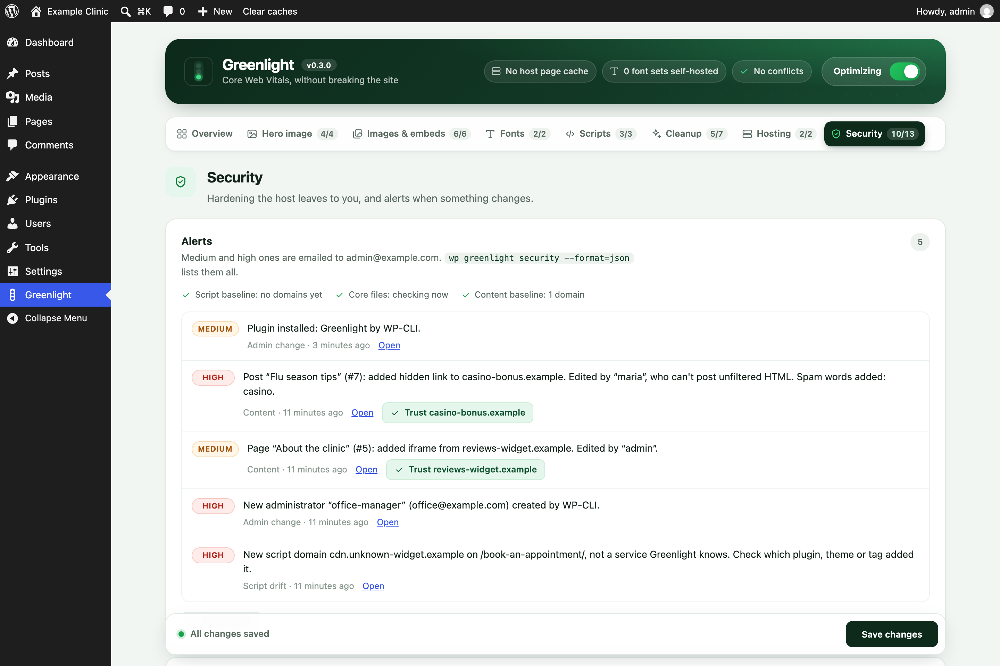
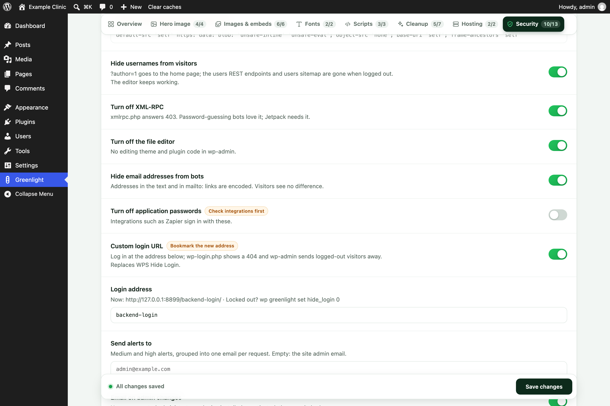

# Greenlight

A WordPress plugin for the front-end fixes that actually move Core Web Vitals (LCP, CLS, TBT, FCP,
Speed Index), built from what worked on real WP Engine sites. **No page cache**: WP Engine, Kinsta,
SiteGround, Flywheel and Pantheon already cache pages at the server (WP Rocket turns its own page cache
off on WP Engine too). Greenlight clears the host's cache when content changes instead.

Since 0.2.0 it also has a **Security** tab: the hardening a managed host leaves to the site, and light
alerts when something changes. Firewall, DDoS protection, backups and malware scanning stay with the
host; matching plugins against vulnerability feeds belongs in the QA app.

Requires WordPress 6.3+ and PHP 7.4+. Current version: **0.3.0**
([download](https://github.com/yoborj/greenlight/releases/tag/v0.3.0), [changelog](CHANGELOG.md)).






## What it does

| Feature | Metric | What it does |
|---|---|---|
| Hero image | LCP | Finds the first big image near the top (an `` or an inline CSS `background-image`), removes lazy-loading from it, adds `fetchpriority="high"` and preloads it (placed after the viewport tag, so phones don't also fetch the desktop copy). Originals wider than 2048px are swapped for WordPress's 2048px copy; phones get the 1536px copy; a WebP copy is made in the background and served once ready (the original file is untouched). |
| Self-hosted Google Fonts | FCP, CLS | Downloads the Google Fonts CSS and woff2 files in the background (WP-Cron), serves them from `uploads/greenlight/fonts/`, preloads the Latin files and removes the connections to Google. Nobody waits for the download. |
| Delay third-party scripts | TBT, INP | Analytics, pixels, chat and widgets load on the first scroll, tap, click, key or mouse move (and after 10 seconds anyway, so analytics counts visitors who never interact; 0 turns that off). **The theme's and plugins' own scripts are never delayed.** Consent tools and call tracking are excluded by default. |
| Defer head scripts | FCP, Speed Index | Uses WordPress's own loading strategies: a `<head>` script is deferred only when everything that depends on it can wait. jQuery and scripts with inline code are left alone. |
| jQuery in the footer | FCP, LCP | Moves jQuery and the scripts that need it to the footer, where WordPress prints them in dependency order. Every page is checked before it's sent: if inline code (or an unknown blocking script) earlier on the page needs jQuery, jQuery is put back right before it. |
| Embeds on interaction | LCP, TBT | Map, Vimeo, review and booking iframes load on the first interaction instead of with the page (each one can be switched off). A Google Map alone is ~450 KB. |
| Lazy-loading | LCP, bandwidth | Native `loading="lazy"` below the fold; the first N images and the hero always load at once. Iframes (maps, embeds) lazy-load. |
| Missing width/height | CLS | Added from the file name (`-1024x683`) or the media library, so the page doesn't jump. |
| Responsive theme images | LCP, bandwidth | Media-library images printed without `srcset` get WordPress's smaller copies, with `sizes="auto"` on lazy images. |
| YouTube thumbnail | TBT, bandwidth | YouTube iframes become their thumbnail and a play button; the player loads on click. |
| Cleanup | small wins | Emoji script, embed discovery, header clutter, Dashicons for visitors, front-end Heartbeat. Optional: jQuery Migrate, block CSS on classic themes. |
| Host cache purge | — | WP Engine (memcached, page cache, CDN), SiteGround, Kinsta, Pantheon, object cache; on save, from the toolbar, or `wp greenlight purge`. |
| Security | — | Hardening and change alerts, below. |

## Security

One switch per feature. The names are the setting keys for `wp greenlight set` and the keys in
`wp greenlight security --format=json`.

### Hardening

| Key | Default | What it does |
|---|---|---|
| `headers` | on | On front-end HTML pages: `X-Content-Type-Options: nosniff`, `Referrer-Policy: strict-origin-when-cross-origin`, `X-Frame-Options: SAMEORIGIN`, `Permissions-Policy: camera=(), microphone=(), geolocation=()`. A header the host, theme or another plugin already sends is left as it is. |
| `hsts` | off | `Strict-Transport-Security: max-age=<hsts_max_age>`, over HTTPS only. The max-age defaults to 300 seconds: raise it (31536000 = a year) once every page works on HTTPS. |
| `csp_report_only` | off | Sends `csp_policy` as `Content-Security-Policy-Report-Only`. Never enforced: Greenlight's inline delayed-script loader has no nonce, so an enforced CSP would block it. Add `report-uri https://…` to the policy to collect reports. |
| `hide_usernames` | on | For logged-out visitors: `?author=N` redirects to the home page, `/wp/v2/users` REST routes don't exist, oEmbed responses drop the author. The core users sitemap is removed. Logged-in users (the block editor) keep everything. |
| `xmlrpc_off` | on | `xmlrpc.php` answers 403 before the rest of WordPress loads; no X-Pingback header. Jetpack needs XML-RPC: when it is active, the Overview lists it as an overlapping plugin and every admin screen shows a warning. |
| `file_editor_off` | on | Defines `DISALLOW_FILE_EDIT`, unless wp-config.php already defines it either way. |
| `email_obfuscation` | on | Email addresses in the page text and in `href="mailto:…"` are encoded with WordPress's `antispambot()` inside Greenlight's HTML pass. Script and style contents, comments and every other attribute are untouched. Visitors see no difference. |
| `app_passwords_off` | off | Turns off application passwords. Integrations such as Zapier sign in with them, so check before switching on. |
| `hide_login` | off | Custom login URL, the job WPS Hide Login does: the login page moves to `/backend-login/` (or `/<login_slug>/`). `wp-login.php` shows the theme's 404, `/login` and `/admin` no longer lead to it, and logged-out visits to wp-admin go to `/404/` (admin-ajax.php, admin-post.php and password-protected posts keep working). Every login, logout and password-reset link WordPress makes, emails included, uses the new address. |

**Custom login URL.** The default address is **`/backend-login/`**. Change it with `login_slug`
(letters, numbers and dashes); an empty address, or one that's refused (`login`, `admin`, `wp-admin` and
similar), falls back to `backend-login`. The Security tab and `wp greenlight status` show the current
address. Moving a site off WPS Hide Login: to keep its address (and people's bookmarks), set
`login_slug` to WPS Hide Login's slug first; then switch this on, check the address, and deactivate WPS
Hide Login (the Overview lists it as an overlapping plugin while both are on). Locked out: `wp greenlight set hide_login 0` brings
`wp-login.php` back. If the login page misbehaves behind a host's page cache, ask the host to exclude
the address. `hide_login` isn't in the `wp greenlight security` JSON, which keeps schema 1 unchanged.

The Security tab doesn't follow the master switch or `?greenlight=off` (anyone could add that to a URL to
strip the headers). The page scope is the same as the speed features: front-end HTML pages only.

### Alerts

Off by default, because they email the site admin address, which on client sites is often the client's.
Set **Send alerts to** (`alert_email`) first. Medium and high alerts are emailed, grouped into one email
per request; low ones are only listed. The Security tab lists the last 25 (200 are kept), with
**Clear alerts**.

| Key | Type | What it watches |
|---|---|---|
| `admin_alerts` | `admin_change` | A new administrator, or a user made administrator (high); a plugin installed or activated, a theme switched (medium). Says who did it: the user, WP-CLI or no logged-in user. |
| `script_drift` | `script_drift` | The external domains pages load scripts from. Switching on (or **Reset baseline**) records the home page's script domains, then learns from logged-out page views for 24 hours. After that, each new domain alerts once: medium when it belongs to a service on the Scripts tab's lists (the alert names it), high when Greenlight doesn't know it. |
| `core_file_check` | `core_files` | Daily, the same logic as `wp core verify-checksums`: core files against the WordPress.org checksums for this version and locale (wp-content skipped), plus files in wp-admin, wp-includes or a root `wp-*` file that core doesn't ship (high), and missing core files (low). Also any PHP file under `wp-content/uploads` (high), except "Silence is golden" placeholders. Each finding alerts once, and again if the file changes. |
| `content_check` | `content_check` | Changes to published posts, pages, synced patterns, templates and menus. See below. |

**Content check.** Built to stay quiet on normal editing:

- Each update is compared with the version before it; only what was added counts. (Content added while
  a post was a draft counts when it's published.)
- Findings: scripts; iframes, objects and embeds; inline event handlers and `javascript:` links; forms
  that post to another site; meta refresh redirects; and links hidden on purpose (`display:none`,
  `visibility:hidden`, the `hidden` attribute, zero font size, off-screen positioning) that point to
  another site. Plain visible links never count.
- Trusted: this site, the domains already in published content when the check was switched on (the
  baseline), and **Trusted domains** (`content_trusted`). That list starts with the embeds Greenlight
  holds back under Images & embeds (maps, Vimeo, YouTube, reviews, booking) plus common form embeds
  (HubSpot, Jotform, Typeform, Google Forms). Each alert with an untrusted domain has a **Trust**
  button.
- Severity by who made the edit. A user with `unfiltered_html` (admins): trusted domains don't alert;
  anything else is medium (inline handlers low). A user without it: scripts, embeds, inline code and
  redirects are high, because kses should have stripped them; hidden links and forms are medium.
- Content that changed with no edit or revision behind it (a direct database write) is always high.
  The daily scan finds it by comparing each post with the fingerprint saved at its last WordPress save.
- **Spam words** (`content_spam_words`, editable) never alert on their own; added ones raise an alert
  one step.
- Page-builder data kept in post meta (e.g. Elementor) and widgets aren't checked.

**Light on the host.** No large downloads: the core checksums (about 170 KB) once per WordPress version.
The daily checks run a few seconds at a time, two minutes apart (`greenlight_security_daily` and
`greenlight_security_batch`), never one long cron job. Script drift reads pages that are already being
built and writes only when a new domain appears. Any error in these checks is skipped; pages are
served unchanged.

## Settings

**Greenlight** (its own item in the wp-admin menu) opens on an **Overview**: how many optimizations are on, one tile per area
(with the PageSpeed metrics it helps), host cache and font status, overlapping plugins, Clear caches,
and **Compare a page** (opens any page with and without `?greenlight=off`). The header holds the
master switch. Tabs: **Hero image · Images & embeds · Fonts · Scripts · Cleanup · Hosting · Security**.

Every feature has its own switch, and every entry in the lists (scripts to delay, never-delay
exceptions, embeds to hold back, images never treated as the hero, never-defer) has its own switch too,
with a readable name ("Meta (Facebook) Pixel", "Google Maps", "CallRail"…), a remove button and a box
to add your own. Switched-off entries stay in the list (saved with a leading `#`). Options that only
work under another switch say so when that switch is off. All tabs are one form: **Save changes** in
the bar at the bottom saves every tab, and the bar shows when there are unsaved changes.

## After installing

Activating or deactivating Greenlight clears the host's page cache, so pages rebuild with (or without)
it. Self-hosted fonts and the WebP hero copy are made in the background after the first page view or
two (about a minute), then the cache is cleared again. Behind Cloudflare, edge copies can take 10–20
minutes to refresh; compare with `?greenlight=off`, or test the origin directly.

## Not breaking the site

- Only plain front-end HTML pages are touched: never wp-admin, AJAX, REST, feeds, previews or the
  Customizer. Any error while optimizing serves the page unchanged.
- Image sizes Greenlight adds (width/height the theme left out) only tell the browser the image's
  shape. They never change how big an image shows, so a logo the theme sizes by height alone can't be
  stretched; the theme's CSS always decides the size.
- `?greenlight=off` on any URL shows the page with the speed features off, for before/after checks.
  The Security tab's features stay on.
- The end of every page's source has a summary, e.g.
  `<!-- Greenlight 0.3.0 (7 ms): fonts: 1 local, lcp: background hero-2048x1365.jpg, delayed: 4, emails: 1 … -->`.
- The Greenlight page warns when another plugin does the same job (WP Rocket, Autoptimize,
  Perfmatters, LiteSpeed Cache, W3 Total Cache, SiteGround Optimizer, Flying Scripts, WP-Optimize),
  or needs something a Security switch turns off (Jetpack and XML-RPC).
- Call tracking or a cookie banner installed **through Google Tag Manager** waits along with GTM. On
  those sites switch off "Google Tag Manager" under Scripts → Scripts to delay.
- Holding tracking scripts back is not cookie consent. When testing consent, scroll the page first
  (without clicking the banner), or use `?greenlight=off`.

## WP-CLI

```
wp greenlight status
wp greenlight purge
wp greenlight fonts [--clear]
wp greenlight set delay_timeout 0
wp greenlight security [--format=json] [--reset-baseline] [--trust=<domain>] [--run-checks] [--clear-alerts]
```

`wp greenlight set <key> <value>` changes any setting; switches take `1` or `0`. Every Security feature
key works, for example:

```
wp greenlight set headers 1
wp greenlight set hsts 1
wp greenlight set hsts_max_age 31536000
wp greenlight set csp_report_only 1
wp greenlight set hide_usernames 1
wp greenlight set xmlrpc_off 0
wp greenlight set file_editor_off 1
wp greenlight set email_obfuscation 1
wp greenlight set app_passwords_off 1
wp greenlight set hide_login 1                 # login at /backend-login/
wp greenlight set login_slug clinic-door       # or another address
wp greenlight set alert_email alerts@example.com
wp greenlight set admin_alerts 1
wp greenlight set script_drift 1
wp greenlight set core_file_check 1
wp greenlight set content_check 1
```

Switching on `script_drift` starts a new script baseline; switching on `content_check` builds the
content baseline (in batches, via WP-Cron).

`wp greenlight security` options:

- `--reset-baseline`: start a new script baseline (the home page now, then 24 hours of learning).
- `--trust=<domain>`: add a domain to the content check's trusted domains.
- `--run-checks`: run the core file check and the content check to the end now, instead of a few
  seconds at a time. Takes seconds, well inside WP Engine's 10-minute SSH limit.
- `--clear-alerts`: delete the stored alerts.

With `--format=json` the output is only the JSON (the options above print nothing). Its shape is a
contract with the QA app (yoborj/wpe-qa-checklist). Any change bumps `schema`.

```json
{"greenlight_version":"0.3.0","schema":1,
 "features":{"headers":true,"hsts":false,"csp_report_only":false,"hide_usernames":true,"xmlrpc_off":true,"file_editor_off":true,"email_obfuscation":true,"app_passwords_off":false,"admin_alerts":true,"script_drift":true,"core_file_check":true,"content_check":true},
 "script_baseline":["googletagmanager.com"],
 "trusted_embed_domains":["calendly.com","google.com","jotform.com","vimeo.com","youtube.com"],
 "alerts":[{"id":"079e8c0cc382","type":"script_drift","severity":"high","time":"2026-10-22T05:16:06Z","message":"New script domain cdn.example.net on /about/, not a service Greenlight knows. Check which plugin, theme or tag added it.","url":"https://example.com/about/","post_id":6}]}
```

- `type`: `admin_change`, `script_drift`, `core_files` or `content_check`. `severity`: `high`, `medium`
  or `low`. `time`: ISO 8601 UTC. `url` is a string or `null`; `post_id` is an integer or `null`.
- `script_baseline`: the script domains the drift check trusts.
- `trusted_embed_domains`: the content check's trusted domains plus the hosts of the embeds held back
  under Images & embeds (a domain covers its subdomains).
- `alerts`: newest first, at most 200.

## Install

Download `greenlight-<version>.zip` from the [GitHub releases](https://github.com/yoborj/greenlight/releases)
and upload it under Plugins → Add New → Upload, or unzip it to `wp-content/plugins/greenlight/`.
Changes per version are in [CHANGELOG.md](CHANGELOG.md). Settings are under **Greenlight** in the
wp-admin menu; the defaults are safe.

## Releasing

Bump `Version:` in `greenlight.php` and `GREENLIGHT_VERSION`, add a CHANGELOG entry, commit, tag
`vX.Y.Z`, then build the zip from the tag (`.gitattributes` keeps docs and dotfiles out of it):

```
git archive --format=zip --prefix=greenlight/ -o greenlight-X.Y.Z.zip vX.Y.Z
gh release create vX.Y.Z greenlight-X.Y.Z.zip --title "Greenlight X.Y.Z" --notes-file <changelog entry>
```
